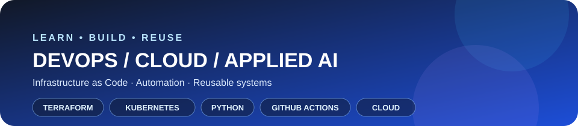

# Hi, I'm Rodrigo 👋

### Student and developer | DevOps, Cloud, automation, and AI

**Learn by building. Automate the repetitive. Reuse what works.**

[LinkedIn](https://www.linkedin.com/in/rodrigo-garcez-hermann/) ·
[GitHub](https://github.com/rg-hermann) ·
[Português](README.md)

---

  

## About me

I'm a technology enthusiast, student, and developer focused on **DevOps and Cloud**. I enjoy exploring how software, infrastructure, and automation connect—building labs, testing ideas, and turning what I learn into reusable solutions.

I'm especially interested in **infrastructure modules, service templates, CI/CD workflows, GitOps, and AI agents**. For me, experimenting also means documenting, validating, and understanding the limits of each solution.

## What I'm exploring

| Area | Technologies and topics |
| --- | --- |
| **Infrastructure** | Terraform, Helm, Kubernetes, Docker, Azure, and AWS |
| **Development** | Python, FastAPI, Java, and Spring Boot |
| **DevOps** | GitHub Actions, CI/CD, GitOps, and reusable components |
| **Applied AI** | AI coding agents, skills, project instructions, and AI-DLC |
| **Quality** | Testing, security, automation, and documentation |

> These technologies reflect personal studies and labs—not a claim of professional experience or production use.

## How I like to build

- **Reusable:** small, clear components that are easy to adapt.
- **Automated:** repetitive tasks with meaningful validation.
- **Responsible:** security, cost, least privilege, and human review matter.
- **Iterative:** start simple, test, learn, and improve based on evidence.
- **AI-assisted, not blindly automated:** agents help; tests and review still matter.

## In my lab

I've been exploring service templates, infrastructure-as-code modules, platform automation, and AI-assisted development workflows. Projects evolve as I learn; I want to share well-documented, useful examples—not just collect tools.

## Currently learning

**AI agent engineering · AI-DLC and SDLC · GitOps · Kubernetes · reusable IaC · secure automation**

## My activity

  <picture>
    <source media="(prefers-color-scheme: dark)" srcset="dist/github-snake-dark.svg">
    <source media="(prefers-color-scheme: light)" srcset="dist/github-snake.svg">
    
  </picture>

---

*Curious by nature. Building, testing, and sharing one lesson at a time.*

