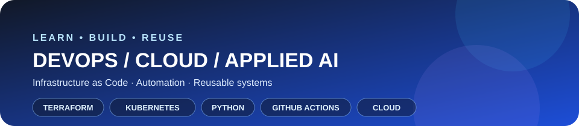

# Oi, eu sou o Rodrigo 👋

### Estudante e desenvolvedor | DevOps, Cloud, automação e IA

**Aprender fazendo. Automatizar o repetitivo. Reutilizar o que funciona.**

[LinkedIn](https://www.linkedin.com/in/rodrigo-garcez-hermann/) ·
[GitHub](https://github.com/rg-hermann) ·
[English](README.en.md)

---

  

## Sobre mim

Sou entusiasta de tecnologia, estudante e desenvolvedor com foco em **DevOps e Cloud**. Gosto de explorar como software, infraestrutura e automação se conectam — construindo laboratórios, testando ideias e transformando aprendizados em soluções reutilizáveis.

Tenho especial interesse em **módulos de infraestrutura, templates de serviços, workflows de CI/CD, GitOps e agentes de IA**. Para mim, experimentar também significa documentar, validar e entender os limites de cada solução.

## O que venho explorando

| Área | Tecnologias e temas |
| --- | --- |
| **Infraestrutura** | Terraform, Helm, Kubernetes, Docker, Azure e AWS |
| **Desenvolvimento** | Python, FastAPI, Java e Spring Boot |
| **DevOps** | GitHub Actions, CI/CD, GitOps e componentes reutilizáveis |
| **IA aplicada** | AI coding agents, skills e instruções de projeto |
| **Qualidade** | Testes, segurança, automação e documentação |

> Tecnologias representam estudos e laboratórios pessoais — não uma afirmação de experiência profissional ou uso em produção.

## Como gosto de construir

- **Reutilizável:** prefiro componentes pequenos, claros e fáceis de adaptar.
- **Automatizado:** automatizo tarefas repetitivas com validações úteis.
- **Responsável:** penso em segurança, custo, permissões mínimas e revisão humana.
- **Iterativo:** começo simples, testo, aprendo e evoluo com evidências.
- **Com IA, sem piloto automático cego:** agentes ajudam; testes e revisão continuam importantes.

## No meu laboratório

Tenho explorado templates de serviços, módulos de infraestrutura como código, automações de plataforma e fluxos de desenvolvimento apoiados por IA. Os projetos evoluem conforme aprendo; quero compartilhar exemplos bem documentados e úteis, não apenas acumular ferramentas.

## Atualmente estudando

**Engenharia com agentes de IA · GitOps · Kubernetes · IaC reutilizável · automação segura**

## Minha atividade

  <picture>
    <source media="(prefers-color-scheme: dark)" srcset="dist/github-snake-dark.svg">
    <source media="(prefers-color-scheme: light)" srcset="dist/github-snake.svg">
    
  </picture>

---

*Curioso por natureza. Construindo, testando e compartilhando um aprendizado de cada vez.*

